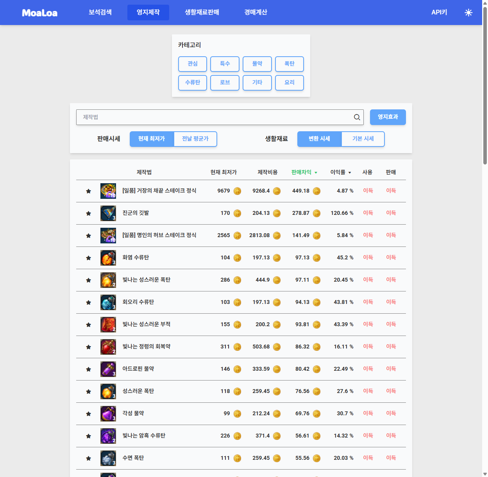
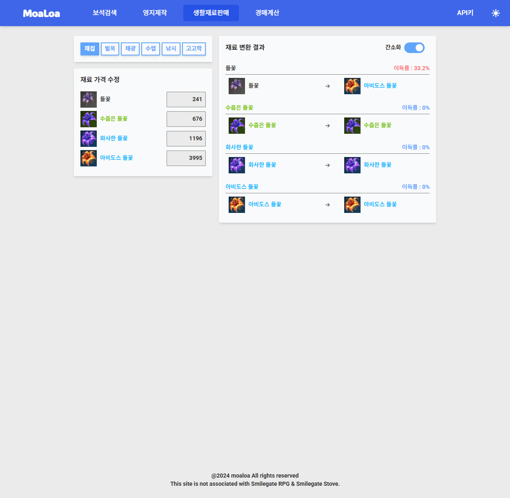
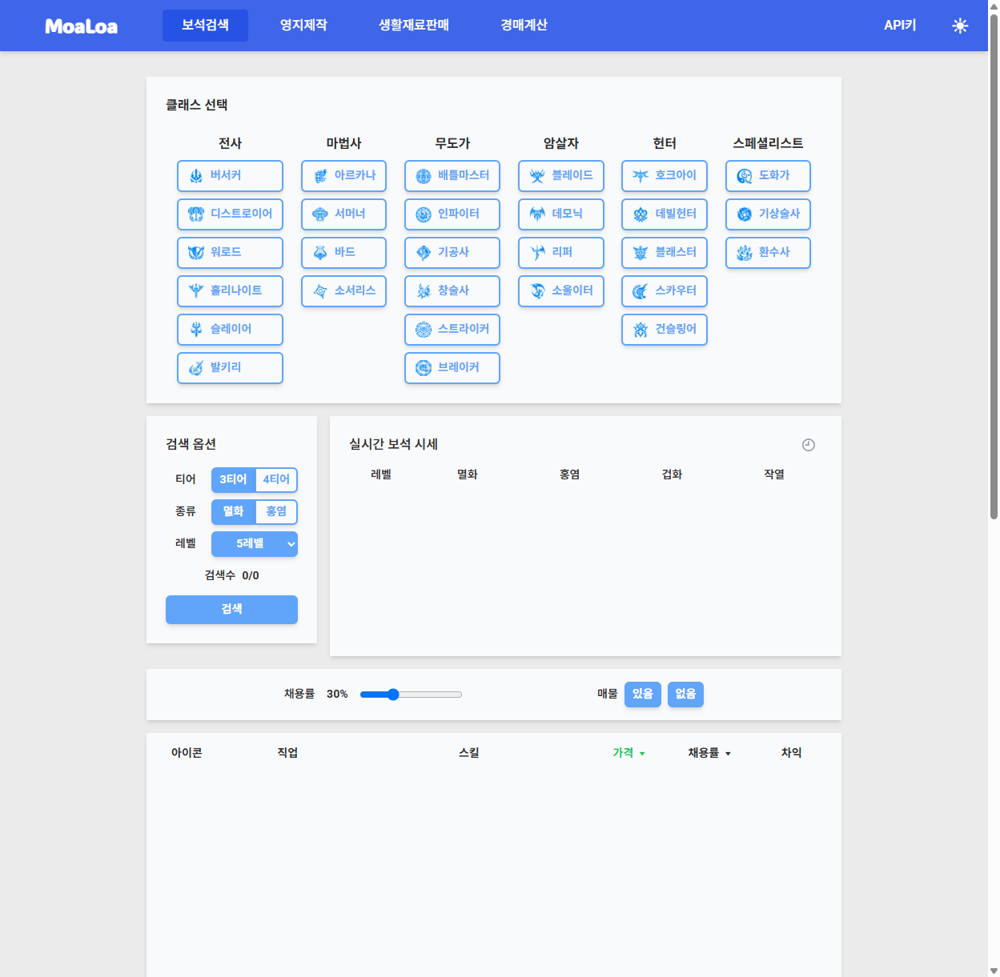
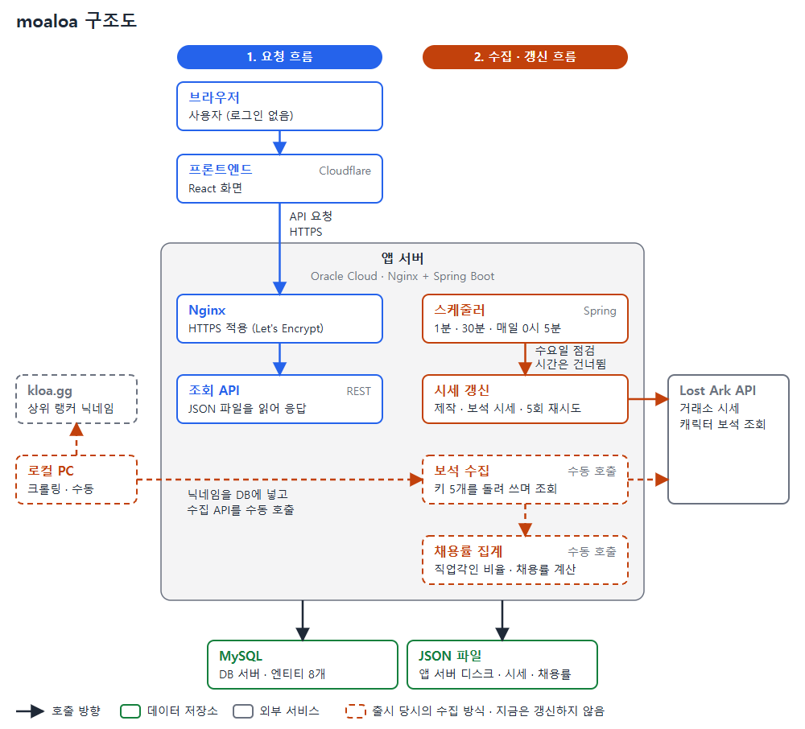
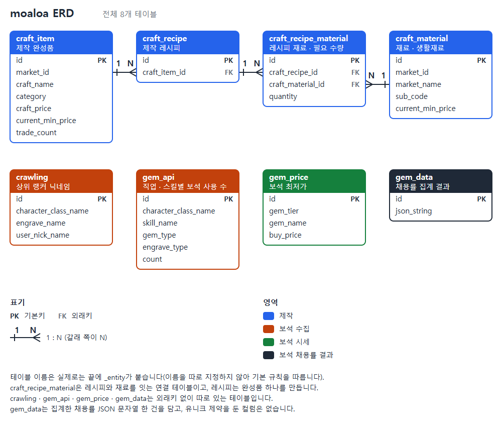

# moaloa (모아로아)

로스트아크 게임의 경제 정보(보석 시세, 영지 제작 효율, 생활재료 판매, 경매 입찰가)를 계산해 주는 도구 모음 사이트.

- 상태: 운영 중 (https://moaloa.org)
- 기간: 2024.10 ~ 2024.12 (출시 2024-12-25), 이후 운영·유지보수
- 인원: 2명 (백엔드·인프라 1, 프론트엔드 1)
- 개발일지: [moaloa 시리즈](https://velog.io/@swmoon7/series/moaloa) (백엔드 기준)

## 화면

서비스 화면. 화면 속 시세·이익률 값은 캡처 시점의 값이다.

| 영지제작 | 생활재료판매 |
|---|---|
|  |  |

보석검색(아래)은 출시 당시의 핵심 기능이었다. 이후 게임 변화로 쓰임이 거의 사라졌고, 메뉴와 데이터는 기록용으로 남겨 두었다.



## 주요 기능

로그인 없이 쓴다.

1. 영지 제작 계산: 제작법별 시세, 제작비용, 이익률. 시세는 1분마다 갱신한다.
2. 생활재료 판매: 직접 판매와 변환 판매 비교.
3. 경매 계산: 경매 입찰가 계산.
4. 보석 검색(출시 당시): 직업별·스킬별 보석 채용률과 보석 시세를 함께 보여 준다. 채용률은 상위 랭커 2,700명(27직업 x 직업각인 2 x 50명)의 보석을 조사해 집계했다. 지금은 갱신하지 않는다.

이익 계산은 프론트에서 하고, 백엔드는 시세와 채용률 데이터를 제공한다.

## 기술 스택

| 구분 | 사용 기술 |
|---|---|
| 백엔드 | Java 17, Spring Boot 3.3.4, Spring Data JPA, Spring Scheduler, spring-retry, Selenium 4.26.0, MySQL |
| 프론트엔드 | React 18.3, TypeScript 5.5, Vite 5.4, Tailwind CSS 3.4, Redux Toolkit |
| 인프라(현재) | Oracle Cloud Always Free(앱 서버·DB 서버 각 1대), Nginx, Let's Encrypt, systemd. 프론트는 Cloudflare |
| 인프라(출시 당시) | AWS Elastic Beanstalk, RDS MySQL, GitHub Actions CI/CD |

## 구조도



- 요청 흐름: 브라우저 → 프론트(Cloudflare) → Nginx(HTTPS) → 조회 API. 조회 API는 DB가 아니라 서버 디스크의 JSON 파일을 읽어 응답한다.
- 갱신 흐름: 스케줄러가 데이터별 주기(제작 시세 1분, 보석 시세 30분, 제작 거래량 매일 0시 5분)로 로스트아크 공식 API를 호출한다. 로스트아크 정기 점검 시간(수요일 6~10시)은 건너뛰고, 실패하면 5회까지 다시 시도한다.
- 점선(보석 수집·채용률 집계)은 출시 당시의 수동 방식이다. 지금은 갱신하지 않는다.

## ERD



엔티티 8개. 제작 4개는 연결돼 있고, 보석 관련 4개(crawling, gem_api, gem_price, gem_data)는 서로 연결되지 않은 독립 테이블이다.

## 내가 맡은 부분

백엔드와 인프라는 내가, 프론트엔드와 프론트 배포·도메인은 팀원이 맡았다.

- 백엔드: 시세 갱신 스케줄러, 조회 API, 보석 수집·채용률 집계, 예외 처리, 로깅
- 인프라: AWS 배포, GitHub Actions CI/CD, HTTPS, Oracle Cloud 이전
- 저장소 기준(2026-11): 전체 커밋 276개 중 142개, 백엔드 경로 커밋 106개 중 97개, PR 12개 중 10개
- 운영 지표(Google Analytics): 출시 첫날 하루 3,000명 이상. 2026-11 기준 최근 1주일 하루 평균 약 20명, 월간 활성 사용자 331명

배포 경과: AWS 무료 계정으로 배포(2024-12) → 무료 1년이 끝나 서버를 내림 → AWS 무료 플랜의 새 계정으로 재배포(2025-12) → 한도를 금방 소진해 다시 내림 → Oracle Cloud Always Free로 이전(2026-01 중순).

### 문제 해결

**1. AWS 첫 배포 후 비용 증가**
- 문제: 배포 테스트 첫날부터 약 3일간 비용이 갑자기 올랐다.
- 해결: 청구서 상세와 비용 관리 탭으로 항목을 추적해, 쓰지 않는 퍼블릭 IPv4와 RDS의 퍼블릭 IP를 원인으로 찾았다. RDS는 프라이빗으로 바꾸고, DB를 확인할 때만 퍼블릭 액세스를 켰다.
- 결과: 배포 첫 달(2024-12) 2.25달러에서 이후 월 평균 0.14달러가 됐다(첫 AWS 계정). 남은 0.14달러는 DB를 확인할 때 RDS 퍼블릭 액세스를 켜서 생긴 비용이었고, 이후 터널링으로 접속하게 바꿔 없앴다.

**2. 공식 API 호출 한도 (출시 당시)**
- 문제: 로스트아크 공식 API는 키 하나당 분당 호출 한도가 있는데, 닉네임 2,700명의 보석을 조회해야 했다. 한도를 넘기면 오류가 났다.
- 해결: 키 5개를 돌려 쓰고(첫 키 370건, 이후 키 80건마다 전환), 5개를 다 쓰면 80초 대기했다. 스케줄 작업에는 도메인별 예외와 `@Retryable`(최대 5회, 80초 간격)을 붙였다.
- 결과: 2,700명 데이터를 수집할 수 있었다. 수 시간이 걸리는 수집을 메서드 하나로 묶어, 중간에 실패하면 처음부터 다시 돌아야 했던 점이 아쉬웠다.

**3. HTTPS 적용**
- 문제: 프론트가 HTTPS인데 백엔드가 HTTP여서 브라우저가 요청을 막았다. ACM 인증서는 로드 밸런서가 필요한데, 프리티어 단일 인스턴스에서는 쓸 수 없었다.
- 해결: Nginx와 Let's Encrypt(Certbot)로 서버에서 직접 인증서를 적용했다. 재배포하면 Nginx 설정이 초기화돼, 설정을 유지하는 방법을 시도했으나 실패하고 재배포 때 인증서를 다시 발급하는 방식으로 정리했다.
- 결과: HTTPS를 적용했다. AWS 시절에는 재배포할 때마다 인증서를 수동으로 다시 발급했다.

**4. 갱신용 API의 외부 노출 (운영 중)**
- 문제: 시세 갱신·수집용 GET API는 서버를 처음 세팅할 때 손으로 부르려고 만든 것인데, 주소만 알면 누구나 부를 수 있었다. CORS로 프론트 주소만 허용해 두었지만, CORS는 브라우저가 붙이는 `Origin` 헤더로 판단하므로 curl 같은 직접 요청은 막지 못한다. 또 Oracle Cloud로 옮길 때 Nginx를 붙이기 전에 확인용으로 연 8080 포트가 그대로 열려 있어, Nginx를 거치지 않고 Spring에 바로 붙을 수 있었다.
- 해결: iptables와 OCI 보안 목록에서 8080을 닫고, Nginx에서 갱신·수집 API 경로를 외부 요청이면 403으로 돌려보내게 했다. 갱신은 스케줄러가 서버 안에서 하고, 손으로 불러야 할 때는 서버에서 `localhost:8080`으로 직접 부른다.
- 결과: 외부에서 갱신 API는 403, 프론트가 쓰는 조회 API는 200으로 확인했다. 코드 수정과 재배포 없이 서버 설정만 바꿨다.

## 실행 방법

필요한 것: JDK 17, MySQL, Node.js

### 백엔드

```powershell
cd back-end
.\gradlew bootRun
```

- 설정(`application.yml`)에서 DB 접속 정보와 아래 이름의 값을 채운다. 값은 저장소에 두지 않는다.
  - 로스트아크 API 키: `loa.api.key1` ~ `key5`, `loa.craft.key6`, `loa.craft.key7` (`key1`~`key5`는 꺼진 보석 수집용이지만, 값이 없으면 앱이 시작되지 않는다)
  - Cloudflare Turnstile 비밀 키: `turnstile.secret` (지금은 쓰지 않지만 시작할 때 읽는다)
  - JSON 파일 저장 경로: `jsonFile.craftData`, `jsonFile.lifeData`, `jsonFile.gemPrice`, `jsonFile.gemData`
- 서버를 처음 실행하면 JSON 파일이 없으므로, 시세 갱신을 먼저 한 번 실행해 파일을 만든다.

### 프론트엔드

```powershell
cd front-end
npm install
npm run dev
```

## 폴더 구조

```
moaloa
├─ back-end
│  └─ src/main/java/moaloa/store/back_end
│     ├─ craft        영지 제작 시세·조회
│     ├─ gemSearch    보석 시세·채용률·크롤링
│     ├─ config       CORS 등 설정
│     ├─ exception    커스텀 예외 10개, 전역 예외 처리
│     ├─ filter       요청·응답 로깅
│     └─ ScheduledTask.java   갱신 스케줄
├─ front-end
│  └─ src
│     ├─ Router       화면(보석검색, 영지제작, 생활재료판매, 경매계산 등)
│     ├─ components, hooks, store
│     └─ ...
└─ .github/workflows  CI/CD(AWS 시절, 지금은 수동 실행만 남김)
```

## 관련 글

velog [@swmoon7](https://velog.io/@swmoon7)

- [moaloa 개발일지 시리즈](https://velog.io/@swmoon7/series/moaloa)
- [[포트폴리오 제작 일지 #2] moaloa 프로젝트 회고](https://velog.io/@swmoon7/포트폴리오-제작-일지-2-moaloa-프로젝트-회고)
- [[Spring] Spring scheduler 정리](https://velog.io/@swmoon7/Spring-Spring-scheduler)
- [AWS 프리티어를 활용한 앱 배포 가이드 (25.07.05기준)](https://velog.io/@swmoon7/AWS-프리티어를-활용한-앱-배포-가이드-25.07.05기준)
- [Route53 없이 HTTPS 적용하는 서브도메인 구성법](https://velog.io/@swmoon7/Route53-없이-HTTPS-적용하는-서브도메인-구성법)
- [Oracle Cloud 마이그레이션 과정에서 겪은 시행착오들](https://velog.io/@swmoon7/Oracle-Cloud-마이그레이션-과정에서-겪은-시행착오들)
- [AWS에서 Oracle Cloud로 서버이전](https://velog.io/@swmoon7/AWS에서-Oracle-Cloud로-서버이전)
- [백엔드 도메인 만료 대응](https://velog.io/@swmoon7/백엔드-도메인-만료-대응)
- [CORS로는 외부 요청을 막을 수 없다: 열려 있던 8080 닫고 Nginx로 API 차단하기](https://velog.io/@swmoon7/CORS로는-외부-요청을-막을-수-없다-열려-있던-8080-닫고-Nginx로-API-차단하기)
